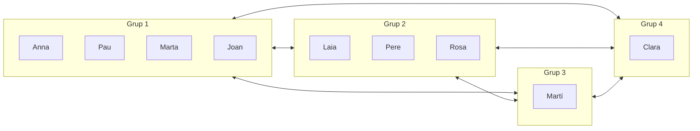
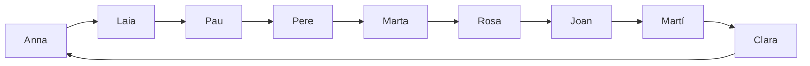

# Amic Invisible

Web estàtica per a l'amic invisible de la família, més un script en Python que fa el sorteig.
Cada persona rep un enllaç secret que només li revela a qui ha de fer el regal.
Ningú no regala a algú del seu propi grup (parella o nucli familiar).

Publicada a <https://quimbf.github.io/AmicInvisible/>.

## Grups

Els noms reals van a `grups.json`, que està al `.gitignore` i no es puja mai.
Crea'l a partir de l'exemple:

```sh
cp grups.example.json grups.json
```

És una llista de grups; cada grup és una llista de noms:

```json
[["Anna", "Pau", "Marta", "Joan"], ["Laia", "Pere", "Rosa"], ["Martí"], ["Clara"]]
```

## Algorisme

### El graf

Cada persona és un node. Hi ha una aresta entre dues persones només si són de **grups diferents**:
són les parelles que es poden fer regals. Amb els grups d'exemple, cada grup està connectat amb tots
els altres (cada fletxa vol dir "tothom d'aquest grup amb tothom de l'altre"):



### El sorteig és un cicle hamiltonià

El sorteig busca un **cicle hamiltonià** en aquest graf: un recorregut que passa per totes les
persones exactament un cop i torna a l'inici. Cadascú regala a la persona següent del cicle. Per
exemple:



Com que és un sol cicle:

- tothom regala exactament un cop i rep exactament un regal;
- ningú no regala ni rep d'algú del seu grup, perquè només es fan servir arestes del graf;
- és **una sola rotllana**: no hi ha parelles tancades que es regalin entre elles (A → B → A),
  i seguint els regals es passa per tothom.

### Com el troba

`cicle_hamiltonia()` fa una cerca amb retrocés (*backtracking*) aleatòria:

1. Tria una persona d'inici a l'atzar.
2. Des de l'última persona del camí, prova els veïns encara no visitats en ordre aleatori
   (`random.SystemRandom`, l'atzar segur del sistema).
3. Si arriba a un carreró sense sortida, desfà l'últim pas i prova el següent veí.
4. Quan el camí té tothom, només el dona per bo si l'última persona pot regalar a la primera
   (tanca el cicle).

Trobar un cicle hamiltonià és difícil en general, però amb una desena de persones és instantani.
Si cap grup no té més de la meitat de les persones, sempre n'hi ha; si no, l'script ho diu i para.

### L'enllaç

Per a cada persona, el text `Et toca fer el regal a: <nom>` es passa a **hexadecimal** i va
darrere del `#` de l'URL. El nom s'omple amb espais perquè tots els codis facin la mateixa
llargada i no se'n pugui endevinar cap per la mida. El navegador no envia mai al servidor el que
va darrere del `#`: la pàgina el llegeix i el desxifra al mòbil de qui l'obre. Qui organitza
envia els enllaços sense veure qui ha tocat a qui.

### Verificació

Abans d'imprimir res, `sorteig.py` torna a llegir la seva pròpia sortida i comprova que tothom
hi surt un cop, que tots els codis fan la mateixa llargada, que ningú es regala a si mateix ni
regala dins del seu grup, que tothom rep un regal i que és un sol cicle. Si alguna cosa falla,
no treu cap enllaç.

## Sorteig

```sh
python3 sorteig.py https://quimbf.github.io/AmicInvisible/ > ~/enllacos.txt
```

Surt un bloc per persona amb el seu enllaç (desa-ho fora del repositori). Envia a cadascú només el seu.
Per fer servir un altre fitxer de grups: `--grups FITXER`.

Per comprovar que el sorteig és vàlid:

```sh
python3 sorteig.py --verifica < ~/enllacos.txt
```

## Tests

```sh
python3 -m unittest
uvx ruff@0.17.5 check . && uvx ruff@0.17.5 format --check .
npm ci && npx playwright test
```

## Publicació

Cada push a la branca per defecte del repositori passa per la CI (gitleaks, lint, tests i e2e)
i, si tot va bé, es desplega a GitHub Pages amb `publica.py`.
